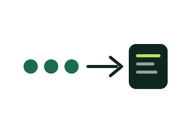

<p align="center">
  
</p>

<h1 align="center">TemizAday</h1>

<p align="center">
  <b>Önce süz, sonra düşün.</b><br>
  CV'leri yapay zekaya göndermeden önce CPU'da süzen, karbon-duyarlı ön filtre.
</p>

<p align="center">
  
  
  
</p>

<p align="center">
  <a href="#nasıl-çalışır">Nasıl çalışır</a> ·
  <a href="#etki">Etki</a> ·
  <a href="#çalıştırma">Çalıştırma</a> ·
  <a href="#ekranlar">Ekranlar</a> ·
  <a href="#teknik-tasarım">Teknik tasarım</a> ·
  <a href="#marka">Marka</a> ·
  <a href="#yol-haritası">Yol haritası</a>
</p>

<p align="center">
  
</p>

---

## Problem

Şirketler bir pozisyon için yüzlerce, bazen binlerce başvuru alıyor ve bunları elemek için büyük dil modelleri (LLM) kullanıyor. Mevcut araçlar spam ve niteliksiz CV'ler dahil **her başvuruyu** modele gönderiyor. Her çağrı veri merkezinde GPU enerjisi ve soğutma maliyeti demek; pozisyonla alakası olmayan CV için harcanan bu enerji israf.

## Nasıl çalışır

Flamingo suyu gagasındaki ızgarayla süzer, yalnızca besini tutar. TemizAday de CV'lerle aynısını yapar. ATS entegrasyonu yok: CV'leri pozisyon başına siz yüklersiniz.

<table>
  <tr>
    <td width="33%" valign="top">
      <br>
      <b>1 · Yükle</b><br>
      Pozisyonu açıp iş tanımını (JD) girin, o pozisyona ait PDF CV'leri panele yükleyin.
    </td>
    <td width="33%" valign="top">
      <br>
      <b>2 · Süz</b><br>
      TF-IDF, kosinüs benzerliği ve anahtar kelime eşleme yalnızca CPU'da çalışır. Eşiğin altındaki CV elenir.
    </td>
    <td width="33%" valign="top">
      <br>
      <b>3 · Yönlendir</b><br>
      Süzgeçten geçen adaylar, seçtiğiniz LLM sağlayıcısına gider. Kalite aynı, çağrı sayısı çok daha az.
    </td>
  </tr>
</table>

Eşiğe yakın adaylar **elenmez**; "inceleme" kuyruğuna düşer. Süzgeç bir hata verirse de aday elenmez, yine incelemeye alınır.

## Etki

Yeşil Panel her pozisyon için engellenen token'ı, kurtarılan Wh'yi ve önlenen gram CO₂'yi anlık gösterir. Hesap Green Software Foundation (GSF) SCI yaklaşımıyla uyumludur.

Örnek pozisyon (12.480 CV, %73 elenme):

| | Enerji |
|---|---:|
| Süzgeçsiz, 12.480 LLM çağrısı | 3.744 Wh |
| TemizAday ile, 3.360 LLM çağrısı | 1.008 Wh |
| Filtrenin kendi maliyeti | 0,25 Wh |
| **Kurtarılan** | **2.736 Wh · 1.300 g CO₂ · 22,8 M token** |

> Rakamlar örnek varsayımdır: 0,3 Wh / LLM çağrısı, 475 g CO₂ / kWh, 2.500 token / CV. Gerçek değerler ölçülmeli ve raporda açıkça yazılmalıdır.

**Filtrenin kendi enerjisi?** Filtre derin öğrenme değil, seyrek matris işlemi kullanır. Yine de enerji harcar, bu yüzden panel kendi maliyetini kazancın yanında gösterir:

```
net kazanç = elenen çağrı × E_llm − Σ E_filtre
```

## Çalıştırma

Çalışan bir MVP: giriş, pozisyon, PDF yükleme, CPU süzgeci, LLM yönlendirme, panel, rapor ve CSV dışa aktarma.

```bash
python3 -m venv .venv && .venv/bin/pip install -r requirements.txt
cp .env.example .env        # ADMIN_PASSWORD ve SECRET_KEY'i değiştirin
set -a && source .env && set +a
.venv/bin/uvicorn app.main:app --reload
```

`http://127.0.0.1:8000` adresini açın ve `.env` içindeki e-posta ve parolayla girin. Sonra:

1. **Pozisyonlar → Pozisyon ekle:** başlık, iş tanımı ve zorunlu anahtar kelimeler.
2. **Pozisyonu aç → CV yükle:** PDF'leri seçin. Süzgeç hemen çalışır, kararlar listede görünür.
3. **Filtre Ayarları:** eşiği kaydırın, etkiyi önizleyin, uygulayın.
4. **Yeşil Panel / GSF Raporu:** kurtarılan enerji, CO₂ ve varsayımlar.

`ANTHROPIC_API_KEY` ayarlıysa süzgeçten geçen adaylar arka planda Claude'a gönderilir (puan ve özet). Ayarlı değilse süzgeç yine çalışır, LLM analizi kapalı kalır.

Gerçek Claude bağlantısını denemek için: `ANTHROPIC_API_KEY=... PYTHONPATH=. .venv/bin/python scripts/try_llm.py` (modelin yanıtını, token sayısını ve süreyi basar; içine prompt injection denemesi koyulmuştur).

Testler: `.venv/bin/pytest` (26 test: süzgeç, ölçüm, yönlendirme, uçtan uca akış, güvenlik)

### Güvenlik ve veri

- **CV metni diskte şifrelidir** (Fernet). Anahtar `DATA_KEY` ortam değişkeninden, yoksa `data/.datakey` dosyasından (0600) gelir. Anahtarı veritabanı yedeğinden ayrı saklayın.
- **CSRF belirteci:** tüm POST istekleri oturuma bağlı belirteç ister.
- **Saklama süresi:** `RETENTION_DAYS=N` ile N günden eski CV metinleri açılışta silinir (karar ve ölçümler kalır). Bir pozisyon ve tüm CV'leri panelden silinebilir.
- **Yarım kalan LLM çağrıları** sunucu yeniden başlayınca tamamlanır.
- LLM'e giden metinde e-posta, telefon, kimlik no ve bağlantılar maskelenir. Ad **sezgisel** maskelenir: "Ad Soyad:" etiketli satır ve CV'nin ilk satırı. Metnin ortasında geçen adlar (referans vb.) maskelenmez.

### Eşik ölçümü

`scripts/eval_threshold.py`, `eval/labelled.json` içindeki etiketli CV'lerde eşik taraması yapar. Bu küme **sentetiktir** (3 pozisyon, 36 CV), gerçek aday verisi değildir:

```
PYTHONPATH=. .venv/bin/python scripts/eval_threshold.py
```

Sonuç (bant ±0,08): eşik 0,25'te nitelikli adayların **%100'ü** elenmiyor, niteliksiz CV'lerin **%81'i** elenip kalanı incelemeye düşüyor ve hiçbiri LLM'e gitmiyor. Skorlar: nitelikli 0,42–0,87, niteliksiz 0,00–0,32. Eşik 0,50 ve üstünde nitelikli adaylar elenmeye başlıyor. Gerçek CV'lerle yeniden ölçmeden bu sayılara güvenmeyin.

### Bilinen sınırlar

| Konu | Durum |
|---|---|
| Veritabanı | **SQLite, tek şirket, tek yönetici hesabı.** Çok kiracılı kullanım için PostgreSQL + RLS gerekir (yapılmadı) |
| İş kuyruğu | LLM çağrıları FastAPI arka plan görevi + açılışta kurtarma. Ayrı worker ve yeniden deneme planlaması yok |
| Skor | Kelime-önek TF-IDF (ilk 5 harf). Karakter n-gram'ı alakasız CV'lere ~0,25 taban skor verdiği için bırakıldı |
| Token sayısı | Karakter sayısından tahmin (≈4 karakter/token) |
| Taranmış PDF | İsteğe bağlı OCR: `pip install -r requirements-ocr.txt` (RapidOCR). **Ölçüldü: Türkçe harflerde ciddi hata yapıyor** ("Şirket" → "μirket", "mühendisi" → "mhendisi"; 4 örnek satırın 0'ı doğru). Bu yüzden OCR ile okunan CV **asla otomatik elenmez**, en kötü ihtimalle "inceleme"ye düşer. İngilizce/ASCII metinde sorunsuz. Docker imajında OCR yok |
| Docker | `docker build` ve konteynerde giriş sayfası denendi; konteynerde PDF yükleme akışı denenmedi |
| Claude çağrısı | İstek biçimi ve yanıt ayrıştırma sahte taşıyıcıyla test edildi; **gerçek API anahtarıyla uçtan uca denenmedi** |
| Enerji katsayıları | 0,3 Wh/çağrı ve 15 W CPU **varsayımdır**, ölçüm değil |

## Ekranlar

| Ekran | Ne yapar |
|---|---|
| Giriş | E-posta, parola ve kurumsal SSO ile oturum açma |
| Yeşil Panel | Kurtarılan Wh, önlenen CO₂, engellenen token, başvuru hunisi, son kararlar |
| Pozisyonlar | Açık pozisyonlar, yüklenen CV sayısı, elenme oranı |
| Pozisyon Detayı | İş tanımı, PDF CV yükleme, aday listesi ve kararlar |
| Filtre Ayarları | Benzerlik eşiği, zorunlu anahtar kelimeler, sınıra yakın adaylar |
| LLM Ayarları | Birincil ve hafif model bağlantıları |
| GSF Raporu | Dışa aktarılabilir etki raporu |
| Tanıtım sayfası | Ürünü anlatan açılış sayfası |

Ekranlar önce tek bir Claude Artifact'ında tasarlandı (özel, yalnızca sahibi açabilir); uygulama bu tasarımı izler.

## Teknik tasarım

Önerilen profil: **modüler monolit, FastAPI + PostgreSQL.**

<details>
<summary><b>Modüller ve karar akışı</b></summary>

<br>

- **Modüller:** `api`, `ingest`, `screening`, `routing`, `metering`, `reporting`, `adapters`. `screening` saf fonksiyonlardan oluşur; sağlayıcı SDK'ları yalnızca `adapters` içinde yaşar.
- **Kuyruk:** PostgreSQL (`SKIP LOCKED`). Redis yalnızca hız sınırı ve önbellek için.
- **Skorlama:** Türkçe için kelime-önek TF-IDF (kosinüs). `İ`/`I`/diakritik katlama ayrıca ele alınır.
- **Karar:** `skor < t_low` elenir; `skor ≥ t_high` ve zorunlu kelimeler tamsa LLM'e gider; diğer her durum "inceleme"ye düşer.

```
queued → extracting → scored
scored → rejected      skor < t_low
scored → review        t_low ≤ skor < t_high, kelime eksik ya da filtre hatası
scored → llm_pending   skor ≥ t_high ve kelimeler tam
```

</details>

<details>
<summary><b>Veri, güvenlik ve KVKK</b></summary>

<br>

- Paylaşımlı çok kiracılı: her satırda `tenant_id`, PostgreSQL RLS.
- CV kişisel veridir. LLM'e gitmeden önce ad, telefon ve e-posta maskelenir; saklama süresi pozisyon başına ayarlanır.
- CV metni güvenilmez veri sayılır (prompt injection): sınırlayıcılı şablon, çıktı şema ile doğrulanır.
- Sunucu URL'den CV çekmez; yalnızca dosya yükleme. Boyut, sayfa ve süre sınırı; okunamayan PDF "okunamadı" işaretlenir, kalanlar devam eder.

</details>

<details>
<summary><b>Henüz belirsiz olanlar</b></summary>

<br>

Köşeli parantezli değerler henüz verilmemiş girdilerdir:

- Doruk QPS ve günlük CV hacmi
- Hata bütçesi sahibi
- Filtre recall hedefi (etiketli altın kümede)
- Wh / token, PUE ve şebeke yoğunluğu katsayıları (ölçümle)
- Yük testi sonrası eşzamanlılık hedefleri

SLO sayıları (ör. ingest p99 500 ms, kullanılabilirlik %99,5, RPO 15 dk, RTO 60 dk) öneridir ve onay bekler.

</details>

## Marka

<table>
  <tr>
    <td bgcolor="#0F2620" width="20%" align="center"><br><b><font color="#EEF3EC">Forest Ink</font></b><br><font color="#9DB5AA">#0F2620</font><br><br></td>
    <td bgcolor="#1D6B4F" width="20%" align="center"><br><b><font color="#FFFFFF">Moss</font></b><br><font color="#FFFFFF">#1D6B4F</font><br><br></td>
    <td bgcolor="#B6E36B" width="20%" align="center"><br><b><font color="#0F2620">Sprout</font></b><br><font color="#0F2620">#B6E36B</font><br><br></td>
    <td bgcolor="#E8A23B" width="20%" align="center"><br><b><font color="#0F2620">Ember</font></b><br><font color="#0F2620">#E8A23B</font><br><br></td>
    <td bgcolor="#EEF3EC" width="20%" align="center"><br><b><font color="#0F2620">Mist</font></b><br><font color="#0F2620">#EEF3EC</font><br><br></td>
  </tr>
</table>

- **Logo:** tek bacağı üzerinde duran flamingo.
- **Renk anlamı:** Sprout yalnızca "kurtarılan" değerler, Ember yalnızca israf ve elenen yük içindir.
- **Yazı tipleri:** Schibsted Grotesk (metin), JetBrains Mono (sayılar).
- **Ses tonu:** net, ölçülebilir, gösterişsiz. Rakam ve birim verir, varsayımı yazar, büyük laf etmez.

## Yol haritası

- [x] `screening` saf fonksiyon, birim testli
- [x] PDF yükleme, metin çıkarma, süzgeç, karar akışı, insan kararı
- [x] LLM yönlendirmesi (PII maskeleme, şema doğrulama, açılışta kurtarma)
- [x] Karbon muhasebesi, panel, GSF raporu, CSV
- [x] CSRF, CV şifreleme, saklama süresi, silme
- [x] Sentetik kümede eşik ölçümü
- [ ] Gerçek etiketli CV'lerle recall/precision ölçümü
- [ ] Gerçek `ANTHROPIC_API_KEY` ile uçtan uca deneme
- [ ] Katsayıları ölçümle doğrula (Wh/çağrı, CPU gücü)
- [ ] PostgreSQL, çok kiracılılık, ayrı worker
- [x] Sezgisel ad maskeleme, Docker imajı
- [x] İsteğe bağlı OCR (taranmış PDF)
- [x] OCR Türkçe kalitesi ölçüldü (zayıf), OCR'lı CV otomatik elenmiyor
- [ ] Türkçe destekleyen bir OCR modeli (ör. Tesseract `tur`)
- [ ] Gerçek ad tespiti (NER)

---

<p align="center"><sub>Ekranlardaki tüm rakamlar örnek veridir. GSF SCI uyumu bir yaklaşımdır, resmi sertifikasyon anlamına gelmez. Logo ve marka adı için ticari marka araştırması yapılmamıştır.</sub></p>
